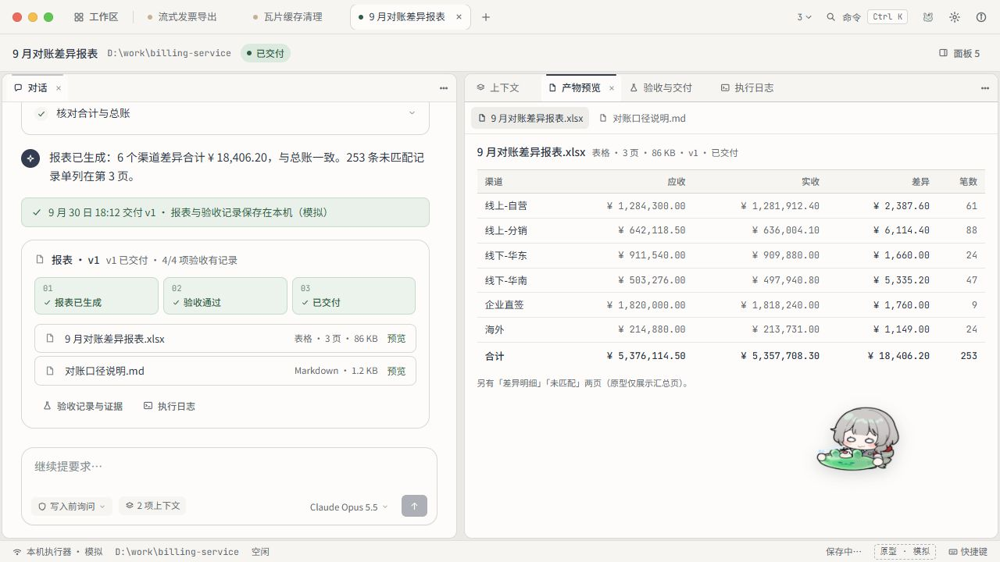
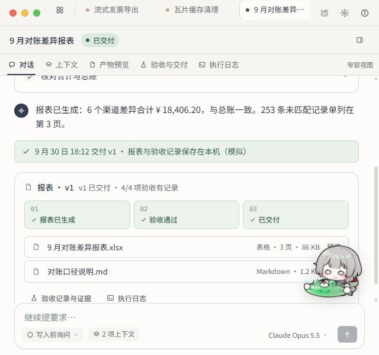
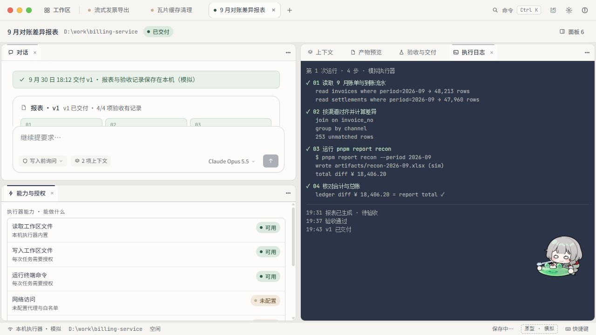

# Pioneer · Make 冻结稿最终验收

> 2026-10-01。结论：**接受为工程实现参考，结束 Make 迭代**。本轮实点发布页并静态核对用户导出的源码，没有修改 Make 稿、发布页面或恢复应用开发。

## 1. 冻结对象

- 冻结编号：**Pioneer-Make-F9**。
- [Make 工程](https://www.figma.com/make/tcAZjzVznDTlTGcMqVGXqj/Desktop-App-Prototype-Design)：编辑器显示 `Version 9 · 完善对话功能与布局`。
- [实点发布页](https://nix-medley-14707825.figma.site/)：作为本次交互证据；网站链接可能被后来发布覆盖，不能代替源码留底。
- 用户提供的 ZIP 已原样复制至 [源码归档](../design/make/frozen/2026-10-01-f9/pioneer-make-f9.zip)，7,134,970 bytes、51 个文件；原件与副本 SHA-256 均为 `fd1758332c24001ad36949fd7e96850d107a507589b5bd5587bfdbc630b5d1cd`。
- [逐文件清单与哈希](../design/make/frozen/2026-10-01-f9/manifest.json)、[浏览器证据目录](assets/figma-make-freeze-2026-10-01/evidence-hashes.json)已留底。没有安装依赖、运行 ZIP 脚本或把其中的规则文件放进活动应用目录。
- ZIP 是用户在此次验收后导出的编辑器源码，包含与实点一致的入口修复、窄窗和桌宠实现；发布页未提供可核对的构建提交号，不声称二者是逐字节相同的部署包。

## 2. 本轮实点结果

PASS 只表示下面列明的浏览器行为，不表示模拟器背后的操作已经在 Electron 实现。

| 检查           | 本轮观察                                                                                           | 结果                             |
| -------------- | -------------------------------------------------------------------------------------------------- | -------------------------------- |
| 首页           | 工作区海报、最近会话和项目内会话入口同时存在；搜索无匹配时显示明确空态，可清除搜索                 | PASS                             |
| 新会话         | 只打开一个完整对话面板，包含工作区身份、建议和输入；没有专注／审阅／交付分页                       | PASS                             |
| 报表产物入口   | 关闭产物面板后，点击 XLSX 卡片重新打开；点击 Markdown 卡片切换到相应内容                           | PASS                             |
| 日志与验收入口 | 关闭后从对话里的“执行日志”“验收记录与证据”重开，保留其他组；已打开时切换到相应标签                 | PASS                             |
| 代码任务入口   | 瓦片任务“打开产物 · 1”显示 Markdown，“执行日志”显示对应运行记录；已有改动组保留                    | PASS                             |
| 报表内容       | 实际显示 6 行渠道汇总和合计；另两页明确标为原型未展示，不冒充完整表格阅读器                        | PASS（展示范围）                 |
| 证据明细       | 展开“证据 3 条”，显示总账、报表合计和模拟查询来源                                                  | PASS（展示行为）                 |
| 面板组合       | 从菜单向下拆分第三组；真实拖动“能力与授权”标签拆到对话下方；Shift+F10 菜单可合并回其他组           | PASS                             |
| 键盘调宽       | 分隔线 ArrowRight 将比例从 46 调到 50；Enter 等分，两列实际宽度相同                                | PASS                             |
| 会话隔离／刷新 | 报表输入临时草稿，切至发票会话输入仍为空；切回和刷新恢复报表草稿与该会话布局                       | PASS                             |
| 标签关闭／恢复 | 新建模拟会话关闭标签后仍在首页；从最近会话重开，拒绝授权状态和消息保留                             | PASS                             |
| 窄窗           | 800×600、640×600 下对话不再挤成两列；640 下可切产物预览；拉回 1280×720 恢复宽窗组合                | PASS                             |
| 桌宠基本交互   | 本体 `pointer-events:auto`、全屏宿主层 `none`；实际拖动位移 −140/−80，Enter 打开菜单、回到角落生效 | PASS                             |
| 模拟权限       | 新模拟任务在文件写入前显示授权卡；选择“拒绝”后进入“已拒绝”，后续写入步骤未完成；卡出现时桌宠收起   | PASS（模拟状态）                 |
| 中文渲染       | Chromium 实际字形使用自定义 Noto Sans SC；正文 Regular、所测标题 Medium，截图无中文方块            | PASS（所测节点）                 |
| 页面报错       | 本次标签所捕获的 warn/error 日志为空                                                               | 未发现报错；不是完整错误路径覆盖 |

临时草稿已经清空。新增的“新会话”只用于模拟验收，内容以“最终验收样例”开头，停在已拒绝；标签已关闭，记录保留，未删除原有样例。面板测试临时增加的能力／预览／日志已收回；关闭重开导致报表组内标签顺序有变化。没有重置浏览器数据或改变应用设置。

### 宽窗最终效果

### 窄窗与拖动证据

## 3. 留给工程处理，不再回 Make 消耗额度

1. **桌宠仍会遮正文。** 原位置盖住报表金额／合计，见[原位置截图](assets/figma-make-freeze-2026-10-01/final-workspace.jpg)。能互动和让按钮，并不等于不挡阅读。工程版要避让结果表格、证据、选区与输入区；没有空位时收至边缘。最终效果截图是手动拖到空白处后的状态，不把它当自动避让已通过。
2. **运行是预置脚本，不理解输入。** 本轮提交“只读梳理模块、不修改文件”，样例仍推进到预设发票修改授权；本轮选择拒绝。该现象用于确认模拟器边界，工程版必须依据真实意图、权限和事件展示，不能照搬脚本推进。
3. **源码里的意图确认被删了，不能删除工程合同。** `store.ts` 迁移会丢弃旧 `intent` 卡，`flow.ts` 驱动模拟步骤；这不是放弃已有 M3 Intent Review、修订失效、READY 和 RuntimeSession bootstrap 的决定。实际界面在对话内承载这些流程，不恢复阶段分页。
4. **离线字体尚未随 ZIP 封装。** ZIP 包含图像／SVG，不含 WOFF/WOFF2；CSS 引用 `static.figma.com`。网页字体通过不等于离线 Electron 通过。实施时复用已有合法本地字体资源并随包分发，不让桌面排版依赖 Figma CDN。
5. **原型的持久化与安全不能直接移植。** localStorage v5、宽松 `any` 验证、静态能力和记住授权都是演示实现。工程继续采用 main 权威、Zod 合同、原子存储、会话隔离及现有 IPC 检查；不把“始终允许”原样变成无限权限。

窄窗拆分／拖动、同模块多实例、浮动原生窗口、命名布局不是此次冻结的完成条件；以后按使用需求另排，不为了像 Premiere Pro 就一次做满。

## 4. 本轮没有验收的范围

- 真实 Pi/provider 调用、工具、文件写入、命令执行、撤销／回滚和真实产物生成。
- 完整代码任务“修改→应用→失败→修复→交付”的所有分支；本轮没有改原有样例的审阅结论。
- 原生红绿灯／托盘／多显示器 DPI、Windows 读屏／强制颜色／200% 缩放和真实 IME 行为。
- 实际 `dsh-manqu-pet` 插件集成、耗电／长时间性能、全套字体离线加载。

这些进入 [冻结稿开发计划](../plans/2026-10-01-pioneer-frozen-prototype-development-plan.md)。历史两轮审阅保留，本报告覆盖本轮已复验项目的旧缺陷，不追改历史 PASS/FAIL。

验收方法参考 [Web Interface Guidelines](https://raw.githubusercontent.com/vercel-labs/web-interface-guidelines/main/command.md) 的键盘替代、焦点和遮挡检查；结论来自本轮页面实点与所归档源码，而非 Make 自报“全部通过”。
