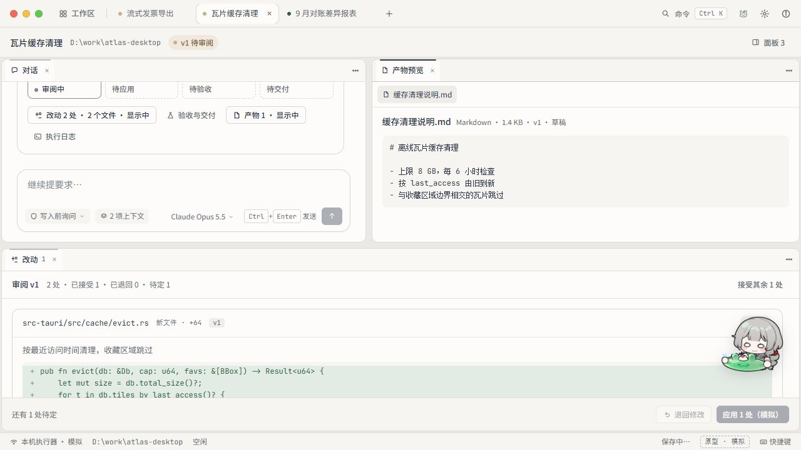
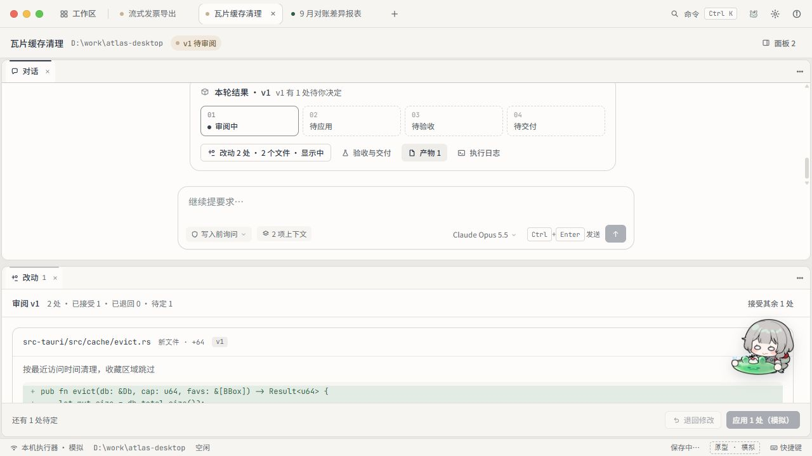
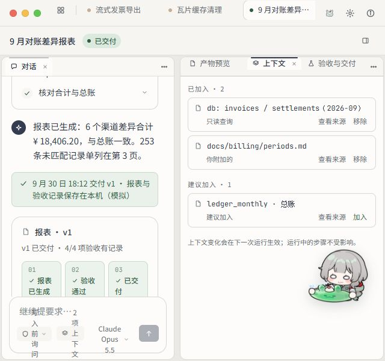

# Pioneer · Make 发布原型第二轮复查

> 2026-10-01。复查用户再次提供的[发布页面](https://nix-medley-14707825.figma.site/)，说明中仍称 Pioneer v5 候选。本记录以本轮实测区分更新前后，不假定同一 URL 的内容永远不变。**应用开发继续暂停**；没有修改源码、ROADMAP、Figma 原稿或真实桌宠插件。

## 结论

本轮已从固定右侧抽屉，推进为真正可拆分、停靠、合并和拖动重组的面板工作台。架构方向可以保留，下一轮应修交互接线与适配，而不是再次重建布局系统。

上一轮的报表回看、默认演示浮层、完成措辞、键盘调宽均有改善。仍不能宣布完整原型验收：部分对话入口无响应；桌宠不挡操作却丢失鼠标互动；窄窗的实际浏览器适配与说明不一致。

[上一轮审阅](figma-make-published-review-2026-10-01.md)是历史问题记录，不再代表所有问题仍存在。[现行设计交接](../design/figma-archive-make-handoff-2026-10-01.md)继续有效：保留 Hazel × Claude 与媒体库首页，PR 指 Adobe Premiere Pro，不恢复专注 / 审阅 / 交付分页，不锁死方位或像素。

## 已实测通过或改善

| 项目           | 本轮可观察证据与边界                                                                                                                                                                     |
| -------------- | ---------------------------------------------------------------------------------------------------------------------------------------------------------------------------------------- |
| 分割与停靠     | 在「瓦片缓存清理」把改动放到对话下方，再从目录向右拆分打开产物。形成上方对话 + 产物、下方改动的三个真实区域，不只是说明文字。                                                            |
| 合并与拖动     | 通过菜单将产物合并到对话组；随后实际把产物标签拖进下方改动组，形成「改动、产物预览」标签组。未穷举所有四边落点。                                                                         |
| 关闭与恢复     | 关闭产物面板后，从全局面板目录恢复成功；关闭不删除会话。对话快捷入口另有下述缺陷。                                                                                                       |
| 键盘调节       | 水平 separator 可聚焦，ArrowDown 将 aria-valuenow 从 50 改为 54，区域高度同步变化。未全量审计焦点顺序与所有快捷键。                                                                      |
| 布局独立与恢复 | 切至报表后再返回瓦片任务，上下布局保留；刷新后上下区域尺寸仍为 315.30 / 267.70 像素。回到报表，其侧边三标签组与已选验收页也保留。仅覆盖这些样例。                                        |
| 已交付报表回看 | 对话有 XLSX / Markdown 产物行。点击 XLSX 预览成功打开表格；从面板目录打开验收，四项标准、交付记录、文件入口可见，「证据 3 条」可展开文本。历史样例不是本轮重新生成或独立验证的财务数据。 |
| 任务类型差异   | 报表展示「报表已生成、验收通过、已交付」三步；代码任务仍待审阅时显示「审阅中、待应用、待验收、待交付」。报表的改动模块禁用并说明没有代码改动。                                           |
| 默认产品视图   | 初次进入与刷新均为铺满窗口的产品视图，没有旧左上测试浮层或模拟任务栏。说明给出演示模式入口；本轮未重新验证其全部窗口行为。                                                               |
| 上下文入口     | 对话发送栏「2 项上下文」能打开 / 激活上下文标签。三个「查看来源」及「加入」按钮中心，命中实际目标而非桌宠。仅此视图通过。                                                                |



## 还需修正

### P1 · 部分对话入口没有打开或聚焦目标面板

- 「瓦片缓存清理」的产物面板关闭时，点击结果卡「产物 1」没有打开它；「执行日志」也没有打开日志。
- 「9 月对账差异报表」点击「验收记录与证据」时，验收模块原本关闭，点击后区域与标签均未变化；从全局目录却可正常打开并展开证据。
- 从全局目录打开执行日志也成功，能看到四步模拟记录。因此不是这些模块都没实现，而是部分入口与面板操作不一致。
- XLSX 预览行、发送栏上下文按钮是已验证的正常入口；不能笼统称所有快捷按钮失效。

建议让同一模块的入口共享一致的打开 / 激活语义：关闭时恢复，藏在组里时选中，已显示时聚焦，不另造重复实例或重排其他组。这是行为要求，未读取源码，不认定内部根因。



### P1 · 桌宠穿透了控件，也失去了鼠标互动

在报表上下文视图，按钮中心不再被桌宠截获，这是改善。但桌宠本体、定位父层及宿主层的 computed pointer-events 全为 none；桌宠中心命中下方上下文容器，而非本体。

尝试从桌宠中心 (1202, 551) 拖到 (1192, 364)，位置仍为 x=1152、y=506.125、100 × 89.875，页面出现底层文字选中。键盘 Enter 仍可打开桌宠菜单，不能据此认定鼠标互动通过。

应同时满足空白区可互动、操作区可让路，而不是以本体全局穿透代替避让。未验证真实 dsh-manqu-pet；本轮也未成功制造「移动后覆盖控件」来验收动态避让。

### P2 · 实际窄窗没有按说明降为单面板

临时设置浏览器为 640 × 600，确认实际 innerWidth=640。仍同时显示宽约 286 与 337 像素的两列，输入权限、上下文、模型等控件开始逐字换行；设计说明却称「窄窗一次显示一个面板，布局树保留」。800 × 600 也仍是分栏。

这不是要求固定 640 像素断点或支持手机。断点与降级形式由设计方判断，但应响应实际窗口宽度，保持输入工具可读，并在恢复宽窗时保留原有组合。若产品另有最小窗口尺寸，应明确说明并保证相应范围可用，而非只通过内置尺寸演示。



## 可直接交给 Make 的收口提示词

```text
请在当前 Pioneer 原型上做一次交互收口，不推倒重画，也不新增一套布局架构。上一轮的真实面板拆分、停靠、合并、拖动重组、键盘调节与会话独立布局已经实测有效；已交付报表也有可用的预览和验收内容。保留这些成果，具体视觉与实现方式由你判断。

保留 Jellyfin 式工作区首页、Hazel × Claude 的低噪声阅读秩序与银灰 / 藏蓝 / 薄荷，以及现有中文字体。PR 指 Adobe Premiere Pro 的面板组合逻辑。基础对话是完整主面板但不锁死方位，不恢复专注 / 审阅 / 交付分页；macOS 红绿灯只补充窗口行为。装饰预算不变，用同槽替换与复用增加多样性。本地 Electron 开发仍暂停。

先修入口一致性：瓦片任务中，关闭产物后点击结果卡“产物 1”没有反应，“执行日志”也未打开；已交付报表点“验收记录与证据”没有打开验收。它们从全局面板目录却都能访问，XLSX 预览和发送栏上下文入口也正常。让所有入口统一遵循：关闭则打开，藏在组里则激活，已显示则聚焦。不要重复创建、偷换其他标签或重排整棵布局。逐个实际点击复测，不以说明替代操作。

桌宠现在不挡上下文按钮，但在实测视图里本体也继承了 pointer-events:none，拖动未位移，底层文字反而被选中；键盘 Enter 能开菜单。把鼠标互动与动态避让一起修好：空白处可点击、拖动和开菜单，操作区可避让或临时穿透。dsh-manqu-pet 继续如实标注未来宿主适配，不声称真实集成完成。

检查真实窗口变窄：640 × 600 的浏览器里仍挤着两列，输入工具逐字换行，和说明中的窄窗单面板不一致。请自行选择合理的断点、最小窗口与降级方式，让输入和面板切换始终好用，恢复宽窗时原布局仍在。不必照抄这一测试尺寸。

收尾时同步设计说明，并演示：从对话入口打开关闭的模块、聚焦已有标签；桌宠在空白处互动且不抢控件；实际宽窄窗口往返；切换会话与刷新恢复。继续保留“新结果只更新入口，用户点击才开面板”的原则，不自动展开、重排或滚走阅读位置。执行器、模型、文件与窗口系统可以继续模拟，明确列出仍模拟和未验证的部分。
```

## 验证边界

- 仅操作公开网页的浏览器本地原型视图与模拟状态。本轮没有发送新任务、应用代码结果、交付、重置原型或上传个人数据。
- 本轮没有重验字体实际字形、全套授权 / 失败 / 断连、所有拖放落点、长期权限撤销、损坏存储与全部窗口行为；上一轮证据不自动升级为新版全量通过。
- 三个面板组合、恢复与命中检查属于浏览器原型证据，不是 Harness、Electron、Windows 原生窗口或真实插件验收。未推进工程里程碑。
- 临时浏览器视口已恢复。没有修改全局配置或共享记忆。
- 截图是审阅证据，不计入应用装饰素材预算。完整本轮截图位于本机 `D:\Project\GitProject\Pioneer\tmp\make-review-round2-2026-10-01`，本文件使用的关键截图另存于研究资产目录。
- 键盘和指针评估参考 [Web Interface Guidelines](https://raw.githubusercontent.com/vercel-labs/web-interface-guidelines/main/command.md)，这是公开原型交互复查，不是源码逐行无障碍审计。
