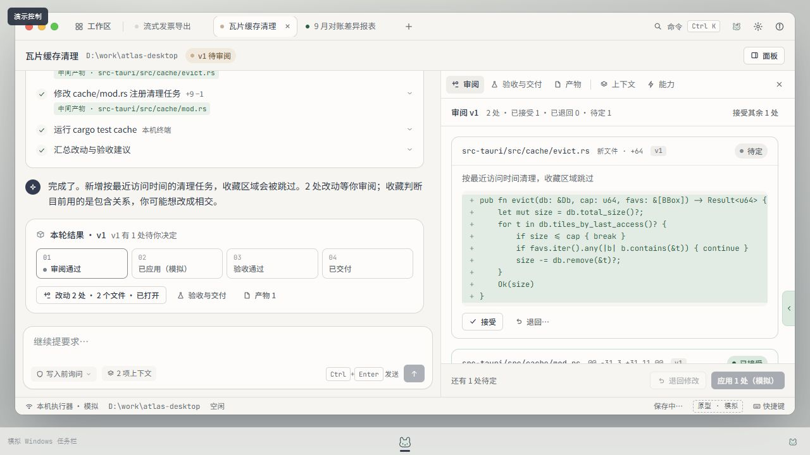
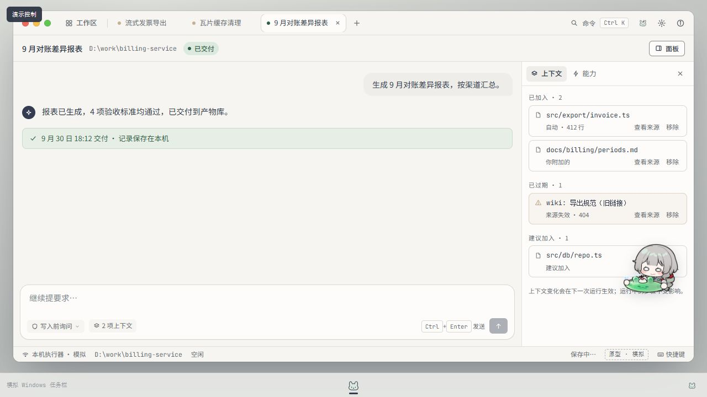
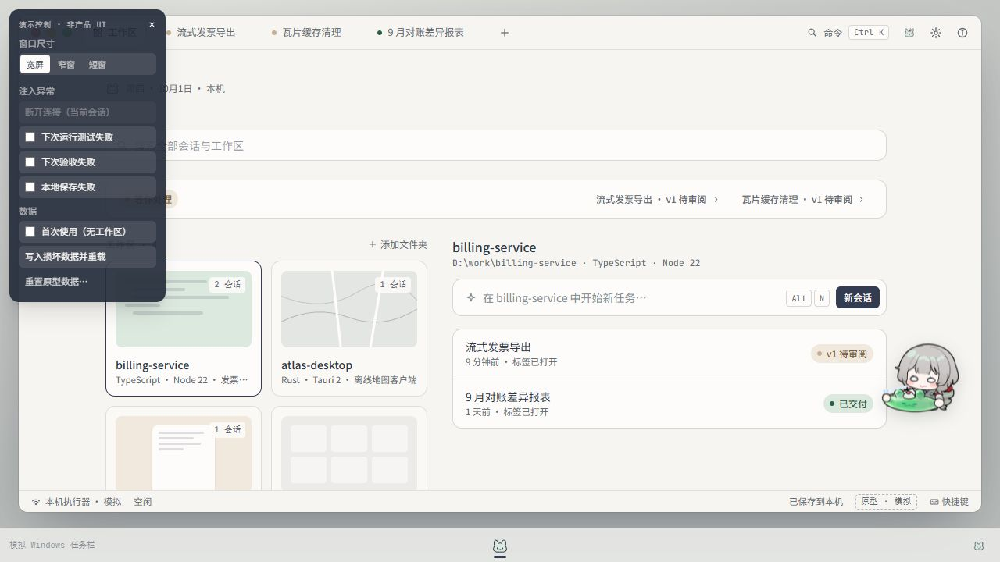

# Pioneer · Make 发布原型审阅与下一轮提示词

> 2026-10-01。对象为公开网页中标注的 **Pioneer v5 候选**，不是已批准的新设计规范。应用开发继续暂停；本轮仅浏览器交互审阅与文档交付，未改应用源码、ROADMAP、Figma 原稿或真实桌宠插件。

公开页面：[nix-medley-14707825.figma.site](https://nix-medley-14707825.figma.site/)。

## 结论与方向

保留现有 Hazel × Claude 视觉和 Jellyfin 式工作区首页。下一轮不是换皮，而是让「对话 + 固定右侧工具抽屉」成为真正可组合的面板工作台，并补齐已交付示例与桌宠避让。

用户当前意图优先于历史 brief：**PR 指 Adobe Premiere Pro**；取消专注 / 审阅 / 交付分页；对话是默认主要面板，不锁死在左侧；结果只提供入口，用户点击才打开，不自动重排。v3.2 是视觉参考，不是像素或布局锁定。[现行交接边界](../design/figma-archive-make-handoff-2026-10-01.md)

## 已实测的可保留部分

| 项目            | 证据与边界                                                                                                                                                                                             |
| --------------- | ------------------------------------------------------------------------------------------------------------------------------------------------------------------------------------------------------ |
| 两款中文字体    | CSS.getPlatformFontsForNode 对欢迎标题返回 Noto Serif SC，8 个字形、isCustomFont=true；对上下文小标题返回 Noto Sans SC，7 个字形、isCustomFont=true。不是仅查看 CSS 声明；未逐字、逐字重验收全部字符。 |
| 工作区首页      | 封面卡片、工作区内会话、最近会话、待处理入口可访问；搜索不存在词显示「没有结果」并可清除。保留首页结构。                                                                                               |
| 基础对话面板    | 欢迎、建议、历史消息、输入栏属于同一会话表面；没有旧的三模式分页。                                                                                                                                     |
| 就地授权        | 模拟发票任务中，修改 invoice.ts、新建 csv-stream.ts、运行 pnpm test export 分别请求授权；只点「允许一次」，未创建长期授权，也未实际操作本机文件或终端。                                                |
| 新结果不抢布局  | 发送前关闭工具面板。运行完成后显示 v1 结果卡，工具面板仍关闭；手动点「改动 3 处 · 2 个文件」才打开。仅此流程通过；未覆盖全部版本更新及滚动位置。                                                       |
| 调宽与恢复      | 分隔线从 x=697 拖至 x=850；切换会话后回到瓦片缓存清理，再刷新网页，分隔线左边界仍为 x=846，当前会话也保留。仅是此次布局与浏览器存储恢复证据。                                                          |
| 窄窗 / 短窗     | 使用网站内置尺寸演示。窄窗审阅可一键返回对话；短窗滚到底后结果按钮可访问。不是全套浏览器断点测试。                                                                                                     |
| 红灯关闭 / 恢复 | 在空输入栏填入临时测试草稿，点红灯后显示「窗口已关闭 · 应用仍在托盘运行」；模拟任务栏恢复后草稿仍在，随后清空本轮测试草稿。不是 Windows 原生托盘、后台任务或 Electron 验收。                           |
| 桌宠局部避让    | 授权、审阅时收至边缘，说明层打开时隐藏。但另有下述点击遮挡缺陷，不能认定桌宠适配完成。                                                                                                                 |

浏览器默认视口 1280 × 720。未访问个人文件、上传数据、修改发布设置、重置原型数据或运行本地应用。

## 优先修正

### P1 · 面板只是固定抽屉，尚未满足组合目标

目前只有一个右侧工具区，可切换审阅、验收与交付、产物、上下文、能力并调宽。尝试把审阅页签拖到左侧内容区，没有形成新的停靠区域。可见原生 draggable 标记属于全局会话标签，不是面板。

未找到拆成独立面板、移动到其他位置、多个不同面板同时排列或重组分组的可操作入口。应升级容器与布局能力，而非继续在唯一抽屉里增加标签。



### P1 · 已交付报表没有可回看的产物入口

打开「9 月对账差异报表」。对话称「4 项验收标准均通过，已交付到产物库」，却没有可点击的产物、验收或交付记录入口；点击顶部「面板」，只出现上下文、能力。

当前公开版这个已交付示例没有闭合交付后的回看流程。不能仅凭绿色状态宣称完整交付原型通过。应补齐报表预览、文件信息与证据入口；没有证据的数据应显示真实缺失状态。

### P1 · 桌宠实际截获上下文按钮点击

同一个已交付会话里打开上下文，默认桌宠与「建议加入」重叠。查看来源按钮范围 x=1144–1198、y=476.25–493.5；加入按钮范围 x=1202–1233、y=476.25–493.5。对两个按钮中心执行 DOM elementFromPoint，命中的都是桌宠按钮 / 图片，而非目标按钮。

这不是单纯的视觉遮挡。宿主层 pointer-events:none 仍不足以防止桌宠可点击本体截获操作；应根据真实操作区避让、收边或临时穿透，保留手动互动与拖动。



### P2 · 演示浮层默认遮挡

首次访问与刷新后，演示控制都展开在左上角，覆盖窗口控制、标题栏和首页。把默认产品视图与测试 / 桌面演示模式分开；收起后的入口也不能占用红绿灯命中区。



### P2 · 完成措辞与键盘操作

结果仍有 3 处待决定时，第一格以活动状态显示「审阅通过」。这是阶段目标与完成措辞易混淆，不是本轮证明了错误状态推进。建议用中性阶段名与实际状态分别表达，普通任务也不必套同一四格流水线。

分隔线 tabIndex=-1，无 aria-valuenow/min/max；未找到键盘调宽入口。新面板拖拽 / 拆分需要菜单或键盘替代，保持可见焦点。参考 [Web Interface Guidelines](https://raw.githubusercontent.com/vercel-labs/web-interface-guidelines/main/command.md)，不是源码级全量审计。

## 可直接交给 Make 的提示词

```text
请基于当前 Pioneer v5 候选继续迭代，保留已经不错的视觉，不要推倒重画。只修改当前 Make 项目，本地 Electron 开发仍暂停。具体尺寸、排版与组件细节由你自主判断；下面是产品意图与实测问题，不是像素锁定清单。

保留 Jellyfin 式媒体库工作区首页，以及 Hazel × Claude 的阅读秩序、银灰 / 藏蓝 / 薄荷、克制陪伴与现有中文字体。macOS 红绿灯与窗口操作是窗口层补充，不覆盖 Pioneer 的品牌设计。装饰预算不变，通过复用、替换同一槽位的素材增加多样性，不靠堆叠图片。

本轮核心：把“对话 + 固定右侧抽屉”升级为 Adobe Premiere Pro 式可组合面板工作台。PR 指 Premiere Pro，不是 Pull Request。借鉴其停靠与重组逻辑，而不是把 Pioneer 改成视频剪辑软件。

区分模块、面板与布局：模块提供内容或能力；面板承载模块实例；布局决定如何组合。基础对话是完整面板，欢迎、建议、消息与发送栏是其内部状态。对话是默认主轴，但不锁死方位；上下文、改动、产物预览、执行记录等按需加入。让独立面板的分割停靠、调宽、分组页签、移动、关闭与恢复真正可操作，让不同内容能同时存在，而非在唯一抽屉里轮流切页。组合方式与默认布局由你设计，不恢复专注 / 审阅 / 交付分页，也不要强迫常驻空面板。

保留“不抢布局”：结果只更新对话入口与状态，用户点开才出现面板，不自动换页、展开或重排，也不滚走正在阅读的位置。关闭面板不删除会话、不停止任务；各会话保留自己的布局、草稿与内容。提供拖拽之外的菜单或键盘操作，别把关键功能藏成只能靠鼠标试探的手势。

补齐“9 月对账差异报表”示例：现在显示已交付、验收通过，却没有可回看的产物或验收入口，面板也只有上下文与能力。让交付结果能从对话明确进入报表 / 文件预览及证据。结果入口按任务类型生成，不把普通问答、报表与代码修改强制套成同一流水线。分清阶段名和实际完成状态，不要在仍待审阅时让“审阅通过”像已经达成。

修复桌宠避让：已交付会话的上下文面板里，桌宠实际截获“建议加入”的“查看来源”和“加入”按钮。dsh-manqu-pet 仍是未来宿主适配目标；当前继续标明模拟，但应根据真实操作区避让、收边或临时穿透，不只在输入或审阅时处理。保留互动与位置恢复，不变成强制侧栏，不遮挡正文、操作或拖拽落点。

将演示控制与模拟 Windows 桌面 / 任务栏放进可显式开启的演示模式。默认产品视图别被测试浮层覆盖，红绿灯别被演示开关占住；保留进入演示模式后的窗口关闭、恢复与异常测试能力。

完成一次真实可操作的组合演示：从对话按需打开不同模块，将内容拆开、移动、重组、关闭再恢复；验证切换会话、刷新后恢复，以及窄窗 / 短窗可用性。执行器、文件和插件可以继续模拟，但面板操作不能只写在说明里。最后简述改动，以及仍模拟或未实现的部分，不以成功文案替代交互闭环。
```

## 证据与边界

- 操作仅影响审阅浏览器中的本地模拟数据 / 视图。发票任务模拟运行完成，留下待审阅结果；未执行应用、验收或交付，未重置原型。
- 报表是网站提供的历史演示数据；本轮未重新生成报表或验证它的验收链。
- 可点击演示、CSS 与命中测试，不证明真实 Harness、文件系统、模型、Git、Windows 窗口或 dsh-manqu-pet 集成。
- 未完整覆盖断连、失败、拒绝、长期授权撤销、损坏数据恢复、退出时任务终止、全部浏览器断点和所有辅助技术。
- [窄窗审阅画面](assets/figma-make-review-2026-10-01/07-narrow-review.jpg)。本轮完整 12 张截图在本机 `D:\Project\GitProject\Pioneer\tmp\make-review-2026-10-01\`；本文件引用的四张另存于研究资产目录，不是应用装饰资产。

下一轮仍以当前用户指令与现行交接边界为准，不恢复历史 brief 的三布局、两列锁定或像素限制。
