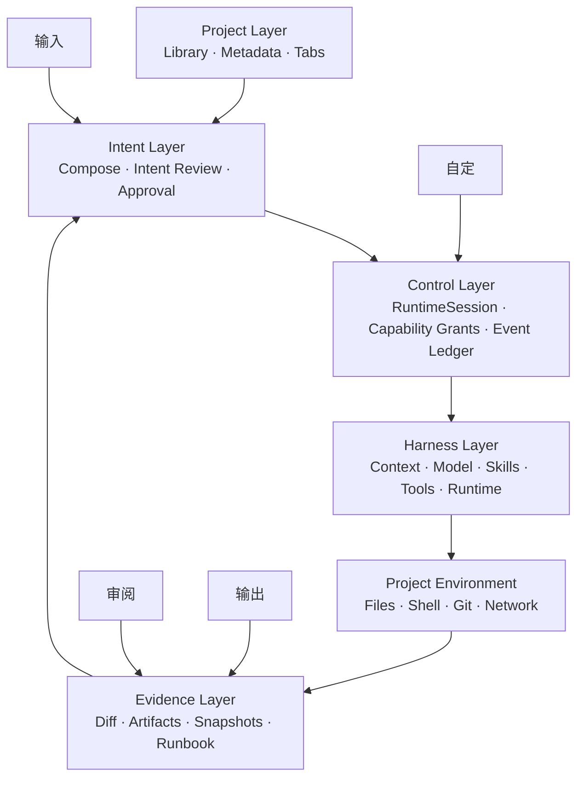
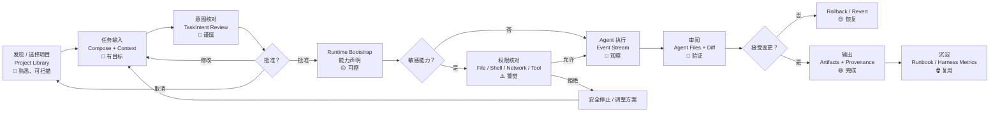
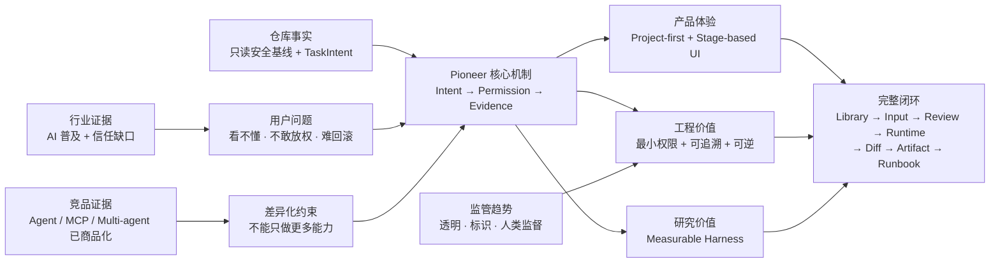

# Pioneer 竞品、行业市场、用户与需求可追溯研究报告

## 执行摘要

**研究日期：2026 年 9 月 29 日。** 本报告假设 Pioneer 的目标市场为**全球可用、以中国个人开发者/创意技术用户为优先落点**；行业数据优先采用近五年资料。仓库事实以 `OasisSaber/Pioneer` 当前 `main` 分支为准，外部竞品以当前官方产品页、官方文档和监管原文为优先依据。

Pioneer 当前最准确的产品定义，不应是“又一个 AI 编程 Agent”，而应是：

> **一个本地优先、项目优先、Human-in-the-loop 的 AI Agent 桌面交互与控制层，并兼具可测量的模块化 Harness 实验底座。**

这一定位来自仓库已经形成的“双主线”：交互上以项目媒体库、Tabs、任务阶段场景、Intent Review 将 Agent 黑盒显式化；工程上以轻量上下文、模块化能力、稳定 Runtime 边界和 Harness 对比实验来控制复杂度。fileciteturn2file0L2-L2 当前真实工程已经完成 M2 只读 Electron 基础，以及 M3 的 `Input → Intent Review → READY` 第一条纵向切片；**尚未接入真实 Agent Runtime、模型、工具执行和项目文件写入**，因此产品今天更接近“安全的 Agent 工作台骨架”，而不是已完成的 coding agent。fileciteturn3file0L2-L2 fileciteturn8file0L2-L2

市场方向成立，但竞争窗口正在迅速收窄。两家商业研究机构对“AI Agents”口径虽不完全一致，却都给出约 **2025 年 78–80 亿美元、2030 年 483–526 亿美元、年复合增长 43%–46%** 的量级；MarketsandMarkets 还把 coding & software development 列为其预测中增长最快的 Agent 角色之一。由于“AI coding agent”“agentic software engineering”“AI agents”尚无统一统计分类，这些数据更适合作为**赛道方向性指标，而非 Pioneer 可直接获取的 TAM**。citeturn20search6turn20search12

需求侧同样存在一个非常适合 Pioneer 的结构性矛盾：AI 开发工具使用率高，但信任并没有同步增长。Stack Overflow 2025 开发者调查显示，84% 的受访者已经使用或计划使用 AI 开发工具，51% 的专业开发者每天使用；与此同时，46% 的开发者对 AI 输出准确性持不信任态度、仅 33% 表示信任，66% 把“答案几乎正确、但并不完全正确”列为最大挫折之一，87% 对 Agent 准确性、81% 对安全和隐私表示担忧。citeturn8view0 这意味着 Pioneer 最值得投资的不是“让 Agent 更自动”，而是让用户能够**看懂将要发生什么、明确授权、查看证据、审核变更并撤销**。

但仓库中 2026 年 9 月 11 日形成的竞品判断需要立即更新。仓库原结论把“侧边栏、固定布局、多 Session 难扫描”视为主要空位，并认为竞品普遍在做能力加法。fileciteturn6file0L2-L2 到 2026 年 9 月底，Cursor 已在官方页面展示 Mission Control、并行 Agent fleets、跨项目任务状态；Claude Code Desktop 已支持多个 session 并排、可视 Diff、定时任务；Devin Desktop 明确定位为统一管理本地与云 Agent fleet 的界面；Cline 也已经发布开源 Desktop，支持并行 Agent、开放模型、MCP、Skills；GitHub 则允许 Copilot、Claude、Codex 等 Agent 从 GitHub 统一被分派任务。citeturn19view0turn13view0turn18search3turn18search16turn11search22 因而，**“多 Agent 控制中心”“桌面 Session 管理”“Diff/回滚”“MCP/Skill”本身已不能作为差异化。**

真正仍有机会形成有辨识度的组合，是以下五点：

| 建议保留的核心 | 战略判断 |
|---|---|
| **Project-first 可视资产库** | 不从聊天/Agent 列表出发，而从“我的项目资产”出发；海报墙适合多项目认知与毕设的视觉设计主线。 |
| **Task-stage workspace** | 输入、审阅、输出、自定不是四个功能页，而是不同认知阶段的信息裁剪机制。 |
| **Intent-before-action** | 批准的是结构化 `TaskIntent` 快照，而不是一句聊天文字；Runtime 不得重新解释已批准意图。 |
| **Permission + evidence UI** | 把文件、Shell、网络、模型、外部工具的能力边界显式 UI 化，并把变更、事件与结果串成证据链。 |
| **Measurable Harness** | 不与大厂比模型，而是用相同模型/任务比较 Harness 的上下文量、成功率、耗时、人工干预次数等指标。 |

前三项已经明确存在于仓库设计和 M3 契约中；其中“Runtime 必须消费已批准 TaskIntent snapshot，而不得重新解释原始指令”的设计尤其值得强化，因为它把 Human-in-the-loop 从一个“确认按钮”升级成了**系统级授权边界**。fileciteturn3file0L2-L2

本报告建议研发优先级因此调整为：

**P0：完成可审计的授权闭环，而不是急于做多 Agent。** 即 `READY → RuntimeSession → capability declaration → explicit permission → event log`。  
**P1：完成真正有展示价值的闭环。** 即文件变更 → Agent Files/Diff → 批准/拒绝 → 快照/回滚 → Artifacts → Runbook。  
**P1：落地 Harness 对照实验。** 否则“轻量上下文/能力模块化”仍只是设计主张。  
**P2：再做自由 Dock、多 Agent fleet、远程 Agent、后台自动化等已经高度商品化的能力。**

这一路径同时符合当前 ROADMAP：M3 正在完成受控任务执行边界，M4 才进入 Pi-Agent 底座桥接、事件总线、会话树与插件能力。fileciteturn8file0L2-L2


## 研究范围、数据源与项目现状

**检索方法。** 本次研究采用“仓库事实 → 官方竞品 → 用户/行业数据 → 监管原文 → 需求回溯”的证据链，而不是先假设功能再寻找支持材料。

仓库部分通过 GitHub 连接器直接读取仓库根目录和权威文档，重点抓取 `README.md`、`PROJECT.md`、`package.json`、`apps/desktop/package.json`、`themasterplan/ROADMAP.md`、`docs/design/M3-INTERACTION-CONTRACT.md`、`开题材料·需求与验收.md` 与 `竞品基线与差异化核查.md`。仓库根目录还显示 `apps/`、`demos/`、`design-specs/`、`docs/`、测试说明及许可证等资产，说明项目同时维护工程实现、历史原型、设计规格和验证材料。fileciteturn1file0L2-L2

外部资料采用以官方域名为主的定向检索，包括 OpenAI、Anthropic、GitHub、Cursor、Cline、OpenHands、Devin、阿里云通义灵码等；行业量化数据采用 Stack Overflow 开发者调查和两家独立市场研究机构交叉校验；中国监管直接读取中国网信网法规原文，欧盟部分采用欧盟委员会 AI Act 页面。市场研究机构的数据被视作 **B 级方向性证据**，厂商自己的采用率/满意度数字被明确视为厂商声明，而不是独立审计结果。citeturn20search6turn20search12

**一个重要限制：本次没有真实用户访谈、问卷原始样本或 Pioneer 产品行为数据。** 仓库自身也明确写明现有 Persona 属于“设计假设，需补充访谈或问卷留痕”。因此本报告给出的 Persona 应定义为 **Proto-Persona（研究假设画像）**，可指导 M3/M4，但不应在论文中写成“用户调研发现”。fileciteturn7file0L2-L2

**项目事实基线如下。**

| 维度 | 当前事实 | 产品含义 |
|---|---|---|
| 产品主题 | 模块化 AI Agent 交互系统；核心哲学为 “Everything is a UI” | 配置、能力、状态、授权尽量界面实体化，而非隐藏在命令/配置中。fileciteturn2file0L2-L2 |
| 当前状态 | M1/M1.5/M2 完成；M3 进行中；已实现 `Input → Intent Review → READY` | 当前不能宣称“Agent 已执行任务”。fileciteturn8file0L2-L2 |
| 当前桌面能力 | 只读根目录选择/扫描、Project Library、项目 Tabs、Settings、任务输入、Intent Review、revision/cancel/READY | 已有优秀的安全地基，但核心价值闭环尚未经过真实执行验证。fileciteturn3file0L2-L2 |
| M2 安全边界 | Main process 拥有文件扫描与设置；preload 仅暴露 `selectRoot/getCatalog/rescan`；renderer 无任意文件系统访问 | 建议将这一最小权限模式复制到未来所有 Tool capability。fileciteturn3file0L2-L2 |
| M3 核心状态 | `draft → reviewing → ready`；批准只改变领域状态，不代表执行 | 为授权、审计和 stale revision 防护提供了强基础。fileciteturn9file0L2-L2 |
| 顶层场景 | `输入 / 审阅 / 输出 / 自定`；Intent Review 属于输入场景 | 可以构成“按任务认知阶段裁剪 UI”的核心 UX 差异。fileciteturn9file0L2-L2 |
| 后续规划 | Runtime bootstrap → 文件变更/快照 → Pi-Agent/事件流 → Session Tree/插件 | 与推荐路线总体一致，但需要强化 permission/evidence contract。fileciteturn8file0L2-L2 |
| 许可证 | MIT | 有利于作品公开、二次研究与开源协作。fileciteturn2file0L2-L2 |
| Runtime 技术栈 | Electron 44.2、React 19.2、TypeScript 6.0、Zod 4.5 | 适合 typed IPC/domain contracts 与桌面本地能力。fileciteturn5file0L2-L2 |
| 工具链 | Node ≥24、pnpm 11.7、Playwright、Vitest、ESLint、Prettier | 已形成 Contract / Prototype / Real E2E 多层证据体系。fileciteturn4file0L2-L2 |
| 质量门禁 | `pnpm check` 串联格式、lint、类型、contract、prototype、real E2E 和 package smoke | 可直接扩展为未来 Agent 变更闭环的可回归证据。fileciteturn2file0L2-L2 |

从产品架构角度，建议将 Pioneer 的逻辑进一步明确为下面四层，而不是“前端 + Agent 后端”：



其中最值得保持的架构原则是：**UI state、approved intent、runtime state 和 model context 必须彼此可区分**。仓库现有设计已经强调 UI 状态与模型上下文分离、显式状态层与事件流；应继续避免把“聊天历史”等同于系统真实状态。fileciteturn2file0L2-L2


## 竞品格局与差异化判断

截至 2026 年 9 月底，coding-agent 产品已经从“IDE 里的聊天/补全”迅速演变成“多 Agent 控制面”。Cursor 官方页面展示了 Mission Control、跨任务的 `In Progress / Ready for Review` 状态和并行 Agent fleet；Claude Code Desktop 支持可视 Diff、多个 session 并排、定时任务；Devin Desktop 直接以管理本地/云 Agent fleets 为产品口号；GitHub 可以统一分派 Copilot、Claude 与 Codex Agent。citeturn19view0turn13view0turn18search3turn11search22

因此竞品不宜再按“是否有 Agent”比较，而应按**谁掌握控制层**比较。

| 产品 | 类型 / 模式 | 当前核心能力 | 对 Pioneer 的直接威胁 | Pioneer 可保留的差异 |
|---|---|---|---|---|
| **Cursor** | 商业；IDE/CLI/Cloud Agent | Mission Control、并行 Agent、独立计算环境、计划/构建、多模型、跨终端/Slack/GitHub；官方称可启动 Agent fleets。citeturn19view0 | **非常高**：过去 Pioneer 的“多任务统一桌面”“控制中心”叙事已被覆盖相当一部分。 | 不与其比 Coding IDE；强调 project library、阶段化 UI、明确授权快照与本地项目资产管理。 |
| **Claude Code / Desktop** | 商业；CLI/IDE/Desktop/Web | 读代码、改文件、执行命令；Desktop 可视 Diff、多 Session、定时任务；支持 MCP、Skills、Hooks、子 Agent。citeturn13view0 | **非常高**：扩展与多 Session 能力非常完整。 | 把审批从“单次工具 permission”提升为 Intent → Session → Capability 的可视证据链。 |
| **OpenAI Codex** | 商业产品 + 开源 CLI | 从规划到 Feature/Refactor/Review，支持多 Agent command center、worktrees 与云环境；CLI 可本地运行。citeturn11search0turn11search4 | **高**：Agent orchestration 已成为核心产品能力。 | 避免竞争模型能力；做 provider/runtime-neutral 的可视控制层与 Harness 实验。 |
| **Devin Desktop** | 商业 | 统一管理本地与云 Agent fleet，Plan / Delegate / Review / Ship。citeturn18search3turn18search38 | **高**：与“Agent 桌面操作系统”的想象直接重合。 | Pioneer 聚焦个人本地项目、可逆授权与研究型 Harness，而非企业工程 Agent fleet。 |
| **GitHub Copilot / Agents** | 商业平台 | IDE agent mode、后台 Coding Agent；GitHub 可给 Copilot、Claude、Codex 分派任务。citeturn11search2turn11search22 | **高**：GitHub 已天然拥有 repo/PR/协作入口。 | Pioneer 本地优先，不依赖 GitHub repo；可以覆盖设计工程、媒体资产和非 Git 工作区。 |
| **Cline** | **开源 + 商业服务** | 开源 Agent runtime；Desktop/IDE/CLI/SDK；Plan/Act、MCP、visual diff、checkpoint、open-weight models，2026 年 9 月新 Desktop 支持并行 Agent。citeturn18search0turn18search8turn18search16turn18search20 | **非常高**：在“开源、模块化、模型自由、本地 Agent”方向与 Pioneer 重叠。 | 更强的视觉项目组织和 stage-based UX；将 Cline 类 runtime 视为可接入底座，而非必须自己重造。 |
| **OpenHands** | **开源 + 商业 Cloud/Enterprise** | model-agnostic coding agents、Agent Canvas 控制中心、本地/自托管/云 backend、真实工程任务执行。citeturn18search5turn18search9 | **高**：开放平台和 control center 定位与 Harness 主线相近。 | 个人桌面 UX、Intent contract、项目资产视觉化和毕业设计可视化表达。 |
| **通义灵码 Lingma** | 商业，中国市场；个人可用 | 编程智能体自动规划、工程感知、文件编辑、终端执行，支持主流 IDE 与自有 Lingma IDE；官方页面称已覆盖“百万开发者”。citeturn22view0 | **中国市场高**：中文、本地生态和企业渠道优势明显。 | 不比代码生成；强调本地控制、跨 Provider/Harness、视觉化项目操作与可测量研究。 |
| **TRAE / TraeCode** | 商业，中国背景、全球产品 | 官方当前定位为 “AI Coding Engineer”，同时提供 TraeWork AI Work Assistant。citeturn22view1 | **中高**：Agent IDE 在国内用户中进一步普及。 | Pioneer 应避免落入“另一个 AI IDE”的同质化路线。 |
| **VS Code AI Agent 能力** | 间接平台竞品 | 官方当前直接以“open source AI code editor”“multi-agent development”定位。citeturn15search9 | **结构性威胁**：IDE 本身越来越像 Agent 控制平台。 | Pioneer 的价值必须超出“编辑代码”：项目、任务、文件变化、产物与 Harness。 |

仓库现有竞品基线正确识别了一个事实：**沙箱、项目规则文件、Plan、子 Agent、MCP/Skills/Hooks、Diff、回滚、Session 恢复、Headless、上下文压缩、成本统计、多模型和文件/Shell 工具，都应被视作基线能力，而不是创新点。**fileciteturn6file0L2-L2 外部资料进一步强化了这一结论：Claude Code 已把 MCP、Skills、Hooks、并行 Agent、Agent SDK 作为标准能力；Cline 也有 MCP、checkpoint、SDK；Cursor 当前已经做并行 fleet。citeturn13view0turn18search8turn19view0

**安全控制同样已成为竞争基线。** Claude Code Manual 模式默认从只读开始，对写文件、执行测试和命令进行显式授权，并提供 sandbox、工作目录边界和网络访问控制；这意味着 Pioneer 的“批准前不写入”非常正确，但只有把它发展成更清晰的 Intent/Capability/Evidence 模型，才足以成为体验差异，而不是单纯追平同行。citeturn13view1

由此建议把竞品地图重新定义为：

| 竞争轴 | Pioneer 应避免 | Pioneer 应争取 |
|---|---|---|
| Agent 智力 | 与 OpenAI/Anthropic/Cursor 比“谁写代码更强” | 接入多个 Agent/runtime，比较 Harness 与 UX |
| IDE | 重做 VS Code/Cursor | 面向项目与任务的桌面 control surface |
| 多 Agent | 数量与并发当卖点 | 什么时候应该出现几个 Agent、谁获权做什么 |
| 扩展 | 再发明 MCP/Skills | 给现有能力模块提供一致 UI/权限/状态语义 |
| Diff | 单纯做一个 Diff viewer | 把 Intent → Action → Diff → Artifact → Rollback 连成证据链 |
| 本地优先 | 仅宣称数据本地 | 明确哪些信息留本地、哪些进入 Provider、哪些 Tool 获得什么权限 |
| “克制” | 只做视觉留白 | **上下文与界面同时按任务阶段裁剪**，并通过实验量化 |

因此，仓库内的一句话差异化“同行在做加法，Pioneer 做减法”仍然有价值，但应升级为更可证明的版本：

> **Pioneer 不追求让 Agent 获得最多能力，而是让每一个阶段只获得完成当前任务所需的最小信息、最小界面和最小权限，并对这种约束是否提高效率与可靠性进行量化。**

这比单纯的“极简 UI”更难被复制，也更适合作为毕业论文研究命题。


## 行业、市场与监管背景

Pioneer 所处的真实市场不是一个单独成熟品类，而是三个市场的交汇：**AI coding assistants → autonomous coding agents → agent orchestration/control surfaces**。商业市场报告的口径因此差异很大，但增长方向高度一致。

MarketsandMarkets 在 2025 年报告中估算全球 AI Agents 市场从 2025 年 **78.4 亿美元**增长至 2030 年 **526.2 亿美元**，CAGR **46.3%**；其分类中 coding & software development agent 预测 CAGR 为 **52.4%**，亚太被视为最快增长区域。BCC Research 2026 年披露的另一套模型则给出 2025 年约 **80 亿美元**、2030 年 **483 亿美元**、CAGR **43.3%**。citeturn20search6turn20search12

| 指标 | MarketsandMarkets | BCC Research | 解读 |
|---|---:|---:|---|
| 2025 全球 AI Agent 市场 | $7.84B | $8.0B | 量级高度接近 |
| 2030 预测 | $52.62B | $48.3B | 均接近 $50B |
| CAGR | 46.3% | 43.3% | 高增长但不确定性也高 |
| 区域信号 | 亚太最快增长 | 北美目前最大 | 对“中国优先、全球可用”假设有一定支持 |
| Pioneer 相关子趋势 | Coding/software agent、multi-agent、build-your-own | 自动化、可定制 Agent | 市场需求存在，但竞争也会极度商品化 |

**这些数字不能直接当 Pioneer 的 TAM。** Pioneer 当前是学生主导的开源桌面系统，其近期可服务市场更合理的定义是：“同时管理多个本地项目、使用一个或多个 AI coding agents、重视审核/数据控制/工作区体验的个人开发者与创意技术用户”。市场规模在缺乏付费意愿、地域和使用频率的一手数据前，不宜伪精确估算。

更重要的是用户行为。Stack Overflow 2025 调查显示 AI 已进入开发主流，但 Agent 还没有：84% 使用或计划使用 AI 开发工具，51% 的专业开发者每天使用；同时仍有约 52% 的开发者不使用 Agent 或只坚持较简单的 AI 工具，38% 表示没有采用 Agent 的计划。citeturn8view0 换言之，市场当前并非“所有人都需要更自治的 Agent”，而是存在一个非常大的**信任迁移阶段**。

调查中还有三个尤其支持 Pioneer 的信号：

**准确性问题。** 46% 主动不信任 AI 输出，超过信任者的 33%；66% 抱怨答案“几乎正确”，45% 认为调试 AI 生成代码有时比自己写更耗时。citeturn8view0 这支持 Intent Review、Diff Review、可逆变更、明确状态语义，而不是“一键全自动”。

**生产率与可控性并存。** 在已经使用 Agent 的开发者中，约七成表示具体任务耗时下降、69% 表示生产率提高，但只有约 17% 感知团队协作改善。citeturn8view0 这意味着 Agent 能“做事”已逐渐解决，但“人如何管理它们、理解它们、协作审阅”仍有空间。

**安全与隐私是核心采购/采用障碍。** 调查中 87% 对准确性、81% 对安全/隐私有顾虑；主流 Agent 厂商也纷纷建立 sandbox、permission、self-hosting、enterprise governance。citeturn8view0turn13view1turn18search5

DORA 2025 对 AI 软件工程的核心判断也值得纳入 Pioneer 的论文逻辑：AI 更像是组织/工程系统现有优势与缺陷的**放大器**，收益不只取决于换一个更强模型，而取决于底层工作系统是否健康。citeturn8view1 这与 Pioneer 研究 Harness、显式状态、测试、权限和上下文组织的路线高度一致。

中国市场方面，阿里云通义灵码已经把“自主规划 → 工程感知 → 文件编辑 → 终端执行”作为标准编程智能体能力，并兼容 VS Code、Visual Studio、JetBrains 和独立 Lingma IDE。其官网自称已覆盖“百万开发者”且满意率超过 87%；该数字应视为**厂商营销数据，而非独立市场统计**，但足以说明中国用户面对的基线产品已经非常成熟。citeturn22view0

**在线数据图表参考**：Stack Overflow 2025 AI 开发者调查包含 AI 工具使用率、信任、Agent 使用方式和安全担忧的原始交互图表，可作为论文图表重绘的数据起点。citeturn8view0 更宏观的 AI 技术与产业指标可以使用 Stanford HAI AI Index 的年度资料作为补充背景。citeturn11search27

从趋势判断，未来一到两年对 Pioneer 最重要的不是“模型继续变强”这一笼统事实，而是五个结构变化：

**从 Copilot 到 delegation。** 用户从实时补全转向把完整任务交给 Agent；GitHub、Cursor、Claude、Devin 均已在支持长期任务或后台执行。citeturn11search22turn19view0turn13view0turn18search38

**从一个 Agent 到控制面。** “当前谁在工作、做到哪一步、等谁审批、哪些变化待审核”变成新一代 UX 核心。Cursor Mission Control 和 Devin Desktop 已直接验证这一方向。citeturn19view0turn18search3

**从模型绑定到 Harness/扩展生态。** MCP、Skills、Hooks、Agent SDK、model-agnostic runtime 成为基础设施。citeturn13view0turn18search20turn18search5

**从聊天记录到可审计执行。** sandbox、权限、Diff、checkpoint、审计日志越来越关键。citeturn13view1turn18search8

**成本和上下文会从隐藏技术指标变成产品指标。** 当并行 Agent、长运行任务普及后，token/context/tool-call/compute 成本持续上升；这使 Pioneer 的“轻量上下文 + Harness 对比实验”比单纯 UI 差异更有长期研究价值。

监管方面，Pioneer 当前**本地毕业设计/研发用途**与“面向公众提供生成式 AI 服务”要明确区分。中国《生成式人工智能服务管理暂行办法》自 2023 年 8 月 15 日实施，第二条适用于向中国境内公众提供生成文本、图片、音视频等内容的服务；第二区分明确指出，企业、教育和科研机构研发/应用生成式 AI 技术但**未向境内公众提供服务**的情形不适用该办法。citeturn14view0 因此当前本地研发版 Pioneer 不应被简单描述成已经需要完成生成式 AI 服务备案，但未来一旦提供公共在线服务，就必须重新做合规边界评估。

若后续对公众提供服务，该办法要求注意个人输入/使用记录保护、内容准确可靠性、知识产权、服务稳定性等；具有舆论属性或社会动员能力的服务还涉及安全评估和算法备案。citeturn14view0

2025 年 9 月 1 日生效的《人工智能生成合成内容标识办法》进一步规定了适用网络信息服务提供者的显式和隐式标识机制；符合适用条件的生成文本、图片、音频、视频、虚拟场景需要按照规定进行相应标识，提供下载、复制、导出功能时也存在相应标识要求。citeturn14view1turn14view2 对 Pioneer 来说，这意味着未来 **“输出 / Artifacts”最好从数据模型一开始就保留 provenance 字段**，而不是以后临时往文件上打标。

全球发行时，欧盟 AI Act 已于 **2026 年 8 月 2 日整体进入适用阶段**，透明度规则也已于 2026 年 8 月生效；欧盟委员会明确采用风险分级框架，并对某些生成式 AI 内容的可识别性、AI 交互透明度提出要求。citeturn17view0turn21search28 Pioneer 作为一般开发工具多数场景未必构成高风险 AI，但“用户知道何时是 AI、谁执行了什么、能够保持人类监督和日志”已经既是 UX 最佳实践，也与监管方向一致。

风险治理方法可以参考 NIST AI RMF。NIST 当前仍把 AI RMF 作为组织管理 AI 风险的通用框架，并正在继续更新相关 profile。citeturn21search26 对 Pioneer 最实用的落地不是引入企业级合规文书，而是保持四件事：**可识别、可授权、可追溯、可撤销。**

综合起来，机会与威胁可归纳为：

| 机会 | 威胁 |
|---|---|
| AI 开发工具普及，但 Agent 信任缺口仍大。citeturn8view0 | Cursor/Claude/Devin/Cline 正快速覆盖“桌面 Agent 控制中心”。citeturn19view0turn13view0turn18search3turn18search16 |
| 本地优先、明确权限、数据边界符合用户安全诉求。 | 安全能力已逐渐成为基线，仅“有审批”不足以差异化。citeturn13view1 |
| 非代码型创意项目的 project-first UI 是 IDE 厂商覆盖较弱的空间。 | 如果实际使用场景最终仍只是改代码，用户会直接选择成熟 IDE Agent。 |
| Harness 组织方法可以形成论文级可量化创新。 | 如果不做真实 A/B 实验，“轻量 Harness”会停留为未经验证的主张。 |
| 中国本地桌面场景可突出数据主权、中文 UX、合规 provenance。 | 中国市场已有通义灵码、TRAE 等强势本地产品。citeturn22view0turn22view1 |
| MIT 开源可让 Pioneer 成为研究/二次开发界面层。fileciteturn2file0L2-L2 | Runtime、Provider、MCP、Agent SDK 快速变化，维护范围可能超过个人项目能力。 |


## Persona、用户故事与用户旅程

以下四个 Persona 是在仓库已有三类设计假设基础上，结合外部用户行为与竞品演进重新整理的 **Proto-Persona**。其中年龄、职业阶段等人口统计属性是**待验证假设**，不是访谈结果。仓库现有材料已经定义“数字媒体毕业生/前端开发者、数字媒体创作者/独立设计师、重度桌面用户”三类核心对象，并明确要求未来补访谈。fileciteturn7file0L2-L2

| Persona | 人口统计与技术水平 | 核心目标 | 主要痛点 | 典型场景 |
|---|---|---|---|---|
| **阿策：学生开发者 / Creative Coder** | 假设 20–24 岁；中国高校数媒/计算机相关专业；中高级前端能力，会 Git、AI coding tool | 同时推进毕设、论文、作品集和多个代码/设计项目；降低上下文切换 | 项目多而碎；Agent 改了什么不放心；反复交代背景；工具分散 | 毕设冲刺、Bug 修复、README/论文与代码同步 |
| **苏苏：独立数字创作者** | 假设 23–35 岁；设计/影像/交互方向；低至中等代码能力 | 用 Agent 处理文件、文档、网页和素材，而不被 IDE/CLI 淹没 | JSON/命令行门槛高；Agent 能力不可见；害怕误删/误移动资产 | 作品集、素材整理、静态站、批量文件任务 |
| **林工：高级开发者 / 桌面效率用户** | 假设 27–40 岁；中高级软件工程经验；高技术熟练度 | 同时管理多个代码库和 Agent session，保持控制、审阅和可恢复性 | Session 增多难找；Agent 输出“几乎正确”；大量 Diff/权限 prompt 造成认知负担 | 多项目维护、重构、依赖升级、review |
| **乔工：开源 Agent / Harness 研究型用户** | 假设 22–40 岁；开发者/研究生/小团队技术负责人；高技术水平 | 在不同模型、Tool、Skill、Harness 之间做可重复实验 | 模型与 Harness 混在一起难归因；上下文不可观测；实验不可复现 | 比较 Provider、测试新 MCP、Agent benchmark、私有本地模型 |

阿策和林工尤其对应真实行业的“高使用但低完全信任”状态：AI 工具使用率已很高，但开发者对于准确性和安全仍普遍担忧。citeturn8view0 苏苏则体现 Pioneer 相对 IDE 产品最重要的一次潜在扩圈：仓库本来就把本地项目、媒体库和数字媒体工作流作为核心设计内容，而不仅仅是代码编辑。fileciteturn2file0L2-L2 乔工则直接服务 Harness 研究主线。

**用户故事建议如下。**

| Persona | 用户故事 |
|---|---|
| 阿策 | **US-A1** 作为同时维护多个毕设项目的学生，我希望打开 Pioneer 就能按视觉卡片辨认项目，以便无需阅读一长串路径名称。 **US-A2** 作为 AI coding 用户，我希望提交任务后先看到系统理解出的 Intent 和步骤，以便在执行前修正误解。 **US-A3** 我希望批准之前任何项目文件都不被修改，以便放心探索复杂任务。 **US-A4** 我希望任务结束后看到成果、变更和 Runbook，以便写论文、录演示并复用流程。 |
| 苏苏 | **US-S1** 作为不熟悉 CLI 的创作者，我希望工具/Skill/权限以 UI 模块显示，以便理解“Agent 会做什么”。 **US-S2** 我希望整理素材前看到源路径→目标路径预览，以免错误移动作品文件。 **US-S3** 我希望一键撤销已执行整理，以便从错误中安全恢复。 **US-S4** 我希望输出文件带来源与 AI 生成状态信息，以便后续发布和归档。 |
| 林工 | **US-L1** 作为多项目开发者，我希望一个窗口同时保留多个项目状态，而不是每次重新建立会话。 **US-L2** 我希望 Runtime 显示当前能力授权、运行步骤和等待批准项，以便快速判断是否需要干预。 **US-L3** 我希望所有改动进入结构化 Diff Review，再决定接受或恢复。 **US-L4** 我希望可以切换 Provider/Harness 而不更改项目工作流，以便避免模型供应商锁定。 |
| 乔工 | **US-Q1** 作为 Harness 研究者，我希望 Context、Skill、Tool、Model 分别成为可配置模块，以便控制实验变量。 **US-Q2** 我希望记录每次实验使用的 model/harness/version/context/token/耗时/结果，以便复现实验。 **US-Q3** 我希望同一 TaskIntent 在多个 Harness 上运行，以便比较差异而不受任务描述变化干扰。 **US-Q4** 我希望使用本地/开源模型和自定义 runtime，以便研究不被单一商业服务限制。 |

用户旅程最关键的设计原则是：**不让用户从“一句 prompt”直接跳到“磁盘发生变化”。** 中间应存在 Intent、能力边界、执行状态和 Evidence 四个可观察层。Claude 等成熟 Agent 也已经采用 permission/sandbox 和 Diff 审阅，这说明这不是附加功能，而是 agentic 软件的核心交互问题。citeturn13view1



其中 A–D 已经部分进入真实 Electron 产品；现行 M3 契约明确到 `READY` 为止，并明确 `READY` **只表示获准给未来 Runtime 使用，不表示已经执行**。fileciteturn9file0L2-L2 E 之后是本报告建议强化的下一阶段。

| 阶段 | 主要触点 | 用户情绪 | 主要风险 | 机会点 |
|---|---|---|---|---|
| 项目发现 | 海报墙、元数据、状态、Tabs | 🙂 | 项目太多仍难找 | 搜索、标签、最近活动；保持“视觉资产库”而非 sidebar |
| 任务输入 | Compose、Context | 🙂 | 不知道 Agent 实际拿到了什么上下文 | Context inspector：清晰说明已选择哪些文件/规则 |
| Intent Review | Intent Card、步骤、revision | 🤔 | 用户把“计划”误认为“已执行” | 保持 `READY ≠ running` 的强语义 |
| Runtime 准备 | Provider、模型、Tool、Skill、权限 | 😐 | 能力默认过大 | capability manifest + 最小授权 |
| 执行 | Event stream、状态 | 😐→🙂 | 无限 telemetry 造成噪声 | 默认摘要，仅异常/等待审批时展开 |
| 变更审阅 | Agent Files、Diff | 🧐 | Diff 太大、无法归因 | 按 Intent step / tool action 分组 |
| 输出 | Artifacts、标准操作 | 😄 | 产物来源不清 | provenance、生成状态、路径、关联 TaskIntent |
| 复用 | Runbook、Harness 数据 | 🤓 | 成功经验留在聊天历史 | 将成功流程变成可调用资产 |

这里正好体现 Pioneer “克制”的最佳实现方式：**少显示不是隐藏信息，而是只在需要决策的阶段显示相应证据。**


## 需求体系与验收

优先级采用 **P0 = 当前 M3 的安全/可运行基础；P1 = 毕设核心闭环和差异化；P2 = 有价值但可以延后**。相比仓库原有 FR-A/B/C，本表增加了当前竞品演进和监管研究后最缺失的“Capability Manifest、Execution Ledger、Artifact Provenance”，同时主动把“多 Agent fleet”下调。

| ID | 类型 / 优先级 | 需求 | 可验收标准 | 研究依据 |
|---|---|---|---|---|
| **FR-01** | 功能 / P0 | 本地项目 Library 以只读方式自动读取项目元数据 | 选择 root 后只扫描批准范围；扫描过程中 fixture byte-for-byte 不变；项目可从卡片进入唯一 Tab | 当前 M2 已形成此边界。fileciteturn3file0L2-L2 |
| **FR-02** | 功能 / P1 | 视觉化项目入口 + 多项目 Tabs | 同一项目不得打开重复 Tab；跨 Tab 切换保持各自任务状态；项目卡至少展示真实而非伪造元数据 | 仓库项目海报墙与 unique tabs。fileciteturn2file0L2-L2 fileciteturn3file0L2-L2 |
| **FR-03** | 功能 / P0 | Task Compose → Intent Review → READY | 空任务被本地拒绝；提交进入 reviewing；返回修改后 revision 增长；Approve 进入 ready；UI 明示“尚未执行” | 当前 M3 正式契约。fileciteturn9file0L2-L2 |
| **FR-04** | 功能 / P0 | Runtime bootstrap 必须消费已批准 TaskIntent 快照 | RuntimeSession 保存批准的 intent/revision；修改原输入后不得静默改变已创建 Session；初始化不自动获得执行权限 | PROJECT 已定义此边界。fileciteturn3file0L2-L2 |
| **FR-05** | 功能 / P0 | Capability Manifest 与细粒度授权 | Runtime 启动时列出 File-read / File-write / Shell / Network / MCP Tool 等能力；默认禁用写入型能力；敏感能力需经过明确 grant | Agent 安全业界已普遍使用 permission/sandbox；Claude Manual mode 默认只读。citeturn13view1 |
| **FR-06** | 功能 / P1 | Execution/Event Ledger | 每次 tool action 均能追溯到 RuntimeSession、TaskIntent revision、时间、能力、结果状态；UI 默认提供摘要而不是伪造 telemetry | Pioneer 已规划显式状态层与事件流；监管/风险治理也强调追溯。fileciteturn2file0L2-L2 citeturn17view0 |
| **FR-07** | 功能 / P1 | Agent Files / Diff Review | 所有写操作完成后可按文件查看变化；用户可明确接受/拒绝；Review 与 pre-execution Intent Review 在 UI 语义上分离 | M3 已把顶层“审阅”保留给未来 Agent Files/Diff。fileciteturn9file0L2-L2 |
| **FR-08** | 功能 / P1 | 可逆快照 / Rollback | 任何由 Agent 产生的受控工作区写操作，在 commit 前有预览；提交后可以恢复到对应 snapshot；自动测试验证恢复后内容哈希一致 | 仓库现有需求把“预览 + 回滚”定义为核心能力。fileciteturn7file0L2-L2 |
| **FR-09** | 功能 / P1 | Artifacts 输出中心 | 输出场景仅显示真实产物；支持打开、文件夹内打开、复制、复制路径；产物关联 originating Session/Intent | PROJECT 已冻结输出场景语义。fileciteturn3file0L2-L2 |
| **FR-10** | 功能 / P1 | Artifact Provenance | 每个生成产物至少记录生成方式、TaskIntent/Session、Provider/model（若存在）、时间与 AI-generated 状态；出口层可根据目标市场添加标识 | 中国生成合成内容标识规则与 EU transparency 趋势。citeturn14view1turn17view0 |
| **FR-11** | 功能 / P1 | Context Inspector / 轻量上下文组装 | 用户可查看本次 Runtime 实际包含的项目规则、文件/摘要、Skill；未选择材料不得静默加入；实验记录可输出 context size | 仓库 Harness 主线及开发者对准确性/可控性的担忧。fileciteturn7file0L2-L2 citeturn8view0 |
| **FR-12** | 功能 / P1 | Tool / Skill / Provider / Runtime 模块化 | 同一 TaskIntent 能在至少两个 Provider/Harness 配置上启动；业务 UI 不直接依赖具体模型 SDK；模块具备稳定 schema | 市场已向 MCP/Skills/SDK/model-agnostic 发展。citeturn13view0turn18search20turn18search5 |
| **FR-13** | 功能 / P1 | Harness 对照实验 | 同一任务和模型可在 ≥2 种 Harness 配置重复执行；自动记录 context 用量、总耗时、成功/失败、工具调用和人工干预；实验环境可复现 | 仓库明确把上下文量/完成率/耗时作为研究目标；DORA 表明底层工作系统值得研究。fileciteturn7file0L2-L2 citeturn8view1 |
| **FR-14** | 功能 / P1 | Runbook 沉淀 | 已完成任务可显式保存为结构化 Runbook；Runbook 不自动包含密钥/隐私路径；再次运行先进入 Intent Review 而非直接执行 | 仓库已将 Runbook 作为媒体库/成果沉淀组成部分。fileciteturn2file0L2-L2 |
| **FR-15** | 功能 / P2 | 自定义工作区组合 | 用户能保存模块布局/场景模板；布局变化不改变领域状态和 Runtime 权限 | 仓库 `自定` 场景与 Everything-is-UI 主线。fileciteturn3file0L2-L2 |
| **FR-16** | 功能 / P2 | 多 Agent / 后台 Agent | 一个项目可存在多个 RuntimeSession，但每个 Session 独立权限和证据链；实现前不得把 Agent 数量作为核心 KPI | Cursor/Claude/Devin/Cline 已高度商品化该能力，因此建议延后。citeturn19view0turn13view0turn18search3turn18search16 |
| **NFR-01** | 非功能 / P0 | 最小权限与进程隔离 | renderer 不暴露 Node、`ipcRenderer`、任意文件 API；新增 IPC 必须有固定 channel/schema、sender validation 与 contract test | M2 已形成明确安全架构。fileciteturn3file0L2-L2 |
| **NFR-02** | 非功能 / P0 | 默认本地、数据最小化 | 未启动外部 Provider 前项目内容不得离开本机；发送外部模型前能够确定发送范围；日志不得写入 API secret | 用户安全/隐私顾虑高；仓库原 NFR 已定义 local-first。fileciteturn7file0L2-L2 citeturn8view0 |
| **NFR-03** | 非功能 / P0 | 状态真实性 | UI 不得展示不存在的 token、成本、tool call、执行成功等；所有状态必须来自真实 domain/runtime event | M3 契约已禁止 fake execution telemetry。fileciteturn9file0L2-L2 |
| **NFR-04** | 非功能 / P0 | 可回归验证 | 所有新 capability、IPC、状态迁移均有 contract tests；关键路径进入 Real Electron E2E；`pnpm check` 为 merge gate | 当前测试体系与主质量门禁。fileciteturn2file0L2-L2 fileciteturn4file0L2-L2 |
| **NFR-05** | 非功能 / P1 | 人类监督与 fail-closed | 未识别 action 默认拒绝而不是默认允许；stale intent/revision 不得执行；中止后状态明确 | 当前 domain 已有 revision/cancel；成熟 Agent permission 体系也采用默认询问/边界控制。fileciteturn9file0L2-L2 citeturn13view1 |
| **NFR-06** | 非功能 / P1 | 合规可配置 | Public-service build 能配置 AI 标识、日志/隐私策略；local research build 不强行引入不适用的联网合规流程 | 中国办法对“向公众提供服务”与内部研发进行了明确区分。citeturn14view0turn14view1 |
| **NFR-07** | 非功能 / P1 | “克制”可测量 | 关键场景记录认知/效率指标，例如完成一个审批所需操作数、无关信息暴露量、context size；不能仅以视觉审美声明“更克制” | 仓库把克制作为双主线原则，但目前缺乏真实用户验证。fileciteturn6file0L2-L2 |

这里最重要的需求变更有三个。

第一，**把权限从“一个 Approve 按钮”提升成正式领域对象**。建议新增类似：

```text
TaskIntent
   ↓ approved revision
RuntimeSession
   ↓
CapabilityManifest
   ↓ user grants
CapabilityGrant[]
   ↓
RuntimeEvent[]
   ↓
ChangeSet / Artifact[]
```

这样可以保证“我批准了这个计划”不等于“我允许任何 Shell/网络/文件操作”。这一点比再增加一个 agent panel 更能形成 Pioneer 的系统价值。

第二，**Harness 实验必须进入产品本身，而不是论文结束前手工跑数据。** 最好把每次 Session 自动保存 `model / provider / harness profile / tools / context bytes-or-tokens / elapsed / interventions / outcome`。这样你的毕设“系统实现”和“实验评价”是同一个系统产出的证据，而不是两套孤立材料。

第三，**不要让 P2 吞噬 P1。** Cursor 已有 fleets，Claude 有并行 Agent，Devin 就是 fleet manager，Cline Desktop 也有 parallel agents。citeturn19view0turn13view0turn18search3turn18search16 Pioneer 在毕业设计周期内投入大量时间重做这些能力，边际价值会低于把 Intent / Permissions / Diff / Snapshot / Artifact / Harness Measurement 做成完整、可演示、可研究的闭环。


## 研究依据追溯与产品决策

为了让需求和论文论证真正可追溯，可以把证据划分为三层：

**A 级：实现事实/官方原始资料。** Pioneer 当前代码与契约、竞品官方文档、法律法规原文。  
**B 级：独立行业研究。** Stack Overflow Developer Survey、DORA、市场研究机构。  
**C 级：待验证设计假设。** Pioneer 仓库已有痛点、Persona、差异化推断。C 级材料不能写成“用户研究证明”，必须通过访谈/可用性测试升级。

核心证据索引如下：

| 证据 | 等级 | 结论 | 被哪些需求使用 |
|---|---|---|---|
| **E-PROJECT** | A | 当前 M2 只读；main/preload/renderer/shared 边界明确；M3 真实 runtime 尚未执行 | FR-01、FR-02、FR-04、NFR-01 fileciteturn3file0L2-L2 |
| **E-M3** | A | `draft→reviewing→ready`；READY 不等于执行；禁止伪执行、文件修改与泛化 FS IPC | FR-03、FR-07、NFR-03、NFR-05 fileciteturn9file0L2-L2 |
| **E-ROADMAP** | A | M3 后续 Runtime bootstrap、受控文件变化；M4 才进入 Pi-Agent、事件流、插件 | FR-04、FR-06、FR-12 fileciteturn8file0L2-L2 |
| **E-REQ** | C/A 混合 | 原始 FR/NFR 已定义 Tabs、Library、Diff/回滚、Intent、场景、轻上下文、模块化能力和实验 | FR-02、FR-08、FR-11、FR-13、FR-14、NFR-02 fileciteturn7file0L2-L2 |
| **E-COMP-REPO** | C | 仓库认为大量 Agent 功能已经属于基线；差异集中在视觉项目、阶段工作区和 Harness 减法 | FR-15、NFR-07 fileciteturn6file0L2-L2 |
| **E-SO** | B | AI 使用率高，但准确性、安全、隐私与调试摩擦显著 | FR-03、FR-05、FR-07、FR-11、NFR-02、NFR-05 citeturn8view0 |
| **E-CLAUDE-SEC** | A | 现代 Agent 采用默认只读、敏感操作审批、sandbox、目录边界和 network controls | FR-05、NFR-01、NFR-05 citeturn13view1 |
| **E-EXTENSIBILITY** | A | Claude/Cline/OpenHands 均向 MCP、Skills、SDK、model-agnostic runtime 发展 | FR-12 citeturn13view0turn18search20turn18search5 |
| **E-CONTROLPLANE** | A | Cursor、Devin、GitHub、Claude、Cline 均进入多 Session/多 Agent 控制层 | FR-16；同时是“不要把多 Agent 当创新”的依据 citeturn19view0turn18search3turn11search22turn13view0turn18search16 |
| **E-DORA** | B | AI 效果受工程系统和组织环境影响，支持 Harness/工作流研究而非只看模型 | FR-13 citeturn8view1 |
| **E-CN-GENAI** | A | 中国公共生成式 AI 服务有特定服务、隐私、安全、备案等要求；纯内部研发存在范围区别 | NFR-06 citeturn14view0 |
| **E-CN-LABEL** | A | 适用场景存在 AI 生成合成内容显式/隐式标识及导出相关要求 | FR-10、NFR-06 citeturn14view1turn14view2 |
| **E-EU-ACT** | A | AI Act 2026 已进入广泛适用阶段，透明度、人类监督、日志/可追溯成为重要治理方向 | FR-06、FR-10、NFR-05 citeturn17view0 |
| **E-MARKET** | B | AI Agent 市场高速增长，但定义口径不统一；Coding Agent 是重要增长场景 | 战略优先级与市场背景 citeturn20search6turn20search12 |
| **E-CHINA-COMP** | A/厂商声明 | 通义灵码已具备规划、工程感知、编辑与终端 Agent，说明中国 coding-agent 基线已很高 | FR-12、竞品差异化 citeturn22view0 |

由这条证据链，可以给出一个更适合产品负责人的最终需求逻辑：



基于全部证据，Pioneer 的产品北极星建议从“功能完整的 Agent 桌面应用”改成一个更加可验证的目标：

> **用户能够在不知道 Agent 内部实现细节的情况下，准确回答五个问题：我在哪个项目？Agent 理解我要什么？我批准它拥有什么能力？它实际上做了什么？我如何接受、撤销并复用这次结果？**

只要这五个问题能够通过 UI 和领域状态得到可靠答案，Pioneer 的 “Everything is a UI” 就不只是美学口号，而会成为系统架构。

相应地，毕业设计的研究命题也可以从宽泛的“模块化 AI Agent 交互系统”进一步收敛为：

> **研究项目优先、阶段化、显式授权的 Agent 交互系统，是否能够在不显著降低任务完成能力的前提下，减少无关上下文、降低用户对 Agent 行为的不确定性，并提升任务审阅与恢复效率。**

建议实验至少比较两类 Harness：一个“规则/上下文较重”的 baseline 与一个 Pioneer lightweight profile。固定同一模型、同一任务集和同一环境，测量 **context tokens、任务成功率、总耗时、tool calls、人工干预次数、错误写入/回滚次数**；用户实验则测量 **Intent 理解正确率、批准前发现错误比例、任务状态判断正确率、完成审核时间和主观信任度**。这种方法与仓库原先计划的 context/完成率/耗时指标一致，但进一步把“交互系统”也变成了可量化研究对象。fileciteturn7file0L2-L2

最终产品范围建议可以压缩成三句话：

**Pioneer 不是模型。** 模型应当可替换。  
**Pioneer 也不必成为另一个 IDE。** 编辑器、Shell、MCP、Agent Runtime 都可以被接入。  
**Pioneer 最值得成为的是 Agent 的人类控制面：项目在哪里、意图是什么、权限有多大、实际发生了什么、结果能否验证和撤销。**

这既延续了当前仓库已经建立的只读 IPC、安全边界、`TaskIntent` 和显式状态设计，fileciteturn3file0L2-L2 也比单纯追赶 Cursor、Claude Code、Devin、Cline 的功能数量更能形成稳定、可答辩、可实现且可通过研究证据证明的差异化。citeturn19view0turn13view0turn18search3turn18search0